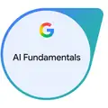

# Hi there, I'm Aneesh! 👋

### Software Engineering · Applied AI · Cloud & Data Systems

**M.S. Computer Science · Virginia Commonwealth University**

---

## About Me

I'm a Computer Science graduate student and Graduate Research Assistant at Virginia Commonwealth University. My work sits at the intersection of software engineering, artificial intelligence, and data systems, with a particular interest in building complete solutions that operate beyond a development environment.

I enjoy connecting the different layers of engineering—from physical devices and data pipelines to intelligent applications and cloud infrastructure—to solve meaningful, real-world problems.

## 🔬 Research & Engineering Experience

### Graduate Research Assistant · Virginia Commonwealth University

*USDA SARE–funded food-loss and waste research initiative*

I'm contributing to an interdisciplinary research initiative aimed at reducing food waste and improving food recovery across university dining operations. The project combines engineering, sustainability, and food-systems research to measure waste, understand consumption patterns, and inform data-driven interventions.

#### PlateTracker — Intelligent Food-Waste Measurement

I develop and deploy an automated plate-waste tracking system in VCU dining operations, integrating Raspberry Pi devices, precision weighing sensors, NFC identification, cameras, and touchscreen applications. It captures measurements at food-serving and dish-return stations, connecting physical workflows with structured digital records. My work spans hardware–software integration, Python development, computer vision research, device reliability, and automated data collection in an active dining environment.

*Project details: [VCU MuSIC Lab — FoodTrack](https://music.lab.vcu.edu/projects/foodtrack/)*

#### Food Waste Analytics — Data Engineering & Decision Support

I develop data-processing workflows that turn PlateTracker's raw measurements into reliable food-waste records, including automated ETL, validation, serving–return reconciliation, and handling incomplete or uncertain observations. The aim is to support analysis across food stations and meal periods, providing a foundation for dashboards, research evaluations, and evidence-based waste-reduction decisions.

*Project context: [USDA SARE — FLW24-004](https://projects.sare.org/sare_project/flw24-004/)*

## 🚀 Selected Projects

Beyond my research, I explore how software engineering, machine learning, and cloud technologies come together to solve different problems. In [Retail Decision Lab](https://github.com/aneeshreddy2304/Retail-Decision-Lab), I built an end-to-end retail analytics platform that combines demand forecasting, promotion analysis, and interactive tools to support planning decisions. My interest in intelligent infrastructure led me to develop [IncidentPilot](https://github.com/aneeshreddy2304/IncidentPilot), an AI-assisted Kubernetes operations platform that brings together system observability, incident investigation, and human-approved remediation. With [AirPulse](https://github.com/aneeshreddy2304/AirPulse), I focused on cloud-based data engineering and machine learning, integrating environmental data pipelines, forecasting models, and API-based inference. I also developed [Wingman](https://github.com/aneeshreddy2304/Wingman), a full-stack roadside assistance platform connecting drivers, mechanics, and service providers through location-aware discovery and coordinated service workflows.

## 🛠️ Technical Skills

**Programming Languages**

       

**AI & Machine Learning**

      

**Backend & Data Engineering**

    

**Cloud, Databases & Infrastructure**

        

**Frontend & Visualization**

    

## 🎓 Education

**Master of Science in Computer Science** · Virginia Commonwealth University

## 🏅 Certifications & Accreditations

-  **AWS Certified Solutions Architect – Associate**
-  **AI Fundamentals — Google**
-  **Academy Accreditation – Generative AI — Databricks**
-  **Claude Code in Action — Anthropic**
-  **AI Fluency Framework & Foundations — Anthropic**
-  **TensorFlow and Keras — Great Learning**
